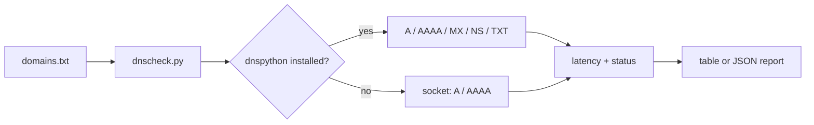

# DNS Health Checker

[](https://github.com/AJJudkins/dns-health-checker/actions/workflows/ci.yml)

DNS failures and slow lookups cause hard-to-diagnose outages. This tool resolves a list of domains, records what came back and how long it took, and flags failures and slow responses.

> Real DNS lookups are the default; `--demo` switches to a canned offline resolver. Sample domain lists use reserved example names only.

## Architecture



## Setup

```bash
git clone https://github.com/AJJudkins/dns-health-checker.git
cd dns-health-checker
# Python 3.9+. Optional for MX/NS/TXT records:
pip install dnspython
```

## Usage

```bash
python dnscheck.py sample_data/domains.txt                      # real lookups, system resolver
python dnscheck.py sample_data/domains.txt --resolver 9.9.9.9   # specific nameserver (needs dnspython)
python dnscheck.py sample_data/domains.txt --timeout 2 --slow-ms 150 --fail-on-slow
python dnscheck.py sample_data/domains.txt --demo               # canned offline resolver, no network
python dnscheck.py sample_data/domains.txt --json
pip install .[dns] && dnscheck domains.txt                      # console script
```

Options: `--resolver IP` (repeatable), `--timeout SECONDS`, `--slow-ms`, `--fail-on-slow`, `--json`, `--demo`.

### Exit codes (for CI / cron / monitoring)

| Code | Meaning |
|------|---------|
| 0 | every domain resolved (slow lookups allowed unless `--fail-on-slow`) |
| 1 | at least one domain failed to resolve (or was slow with `--fail-on-slow`) |
| 2 | usage or input error (bad file, invalid domain name, bad resolver IP, bad timeout) |

Input is validated: each line must be a syntactically valid domain name (`#` comments allowed).

## Sample output

```text
resolver: socket (A/AAAA only)
example.com                  ok        0.0 ms  192.0.2.10
example.org                  slow    250.1 ms  192.0.2.10
example.net                  ok        0.0 ms  192.0.2.10
this-domain-should-not-exist.invalid fail      0.0 ms  NXDOMAIN

3/4 resolved, avg latency 83.4 ms

(Output of `--demo`: canned data using documentation address 192.0.2.10, with one simulated slow lookup and one simulated NXDOMAIN. Real runs depend on your resolver and network.)
```

## Tests

```bash
pip install -r requirements-dev.txt
pytest
```

## What this demonstrates

- Graceful optional dependency handling (dnspython with a standard-library fallback)
- Injectable resolver and clock, so tests run offline with mocks and no real DNS
- Latency measurement and simple status classification (ok / slow / fail)
- JSON output suitable for further tooling

## Limitations

- Real mode makes DNS queries from your machine; results depend on your local resolver.
- Some networks or sandboxes answer every name with a wildcard address, which makes failures impossible to detect.
- Single query per domain: no retries, no percentile statistics, no DNSSEC checks.
- The 200 ms slow threshold is arbitrary.
- The socket fallback only reports A/AAAA records.

## Security and testing status

- **Safety:** read-only DNS queries only; real resolution is the default and `--demo` is an explicit offline mode. Inputs are validated, queries have a timeout (default 3 s), and the tool never writes or changes anything.
- **Tested:** exit codes and input validation (offline, with fake resolvers and the demo resolver); one manual run of real lookups with dnspython against the system resolver and `--resolver 1.1.1.1` in a container whose network answers every name with a wildcard address, so NXDOMAIN detection could not be confirmed there.
- **Not tested:** NXDOMAIN/timeout behavior against real nameservers; custom `--resolver` against internal DNS; Windows/macOS; the standard-library fallback on networks with unusual resolvers.
- See [SECURITY.md](SECURITY.md).

## License

MIT
