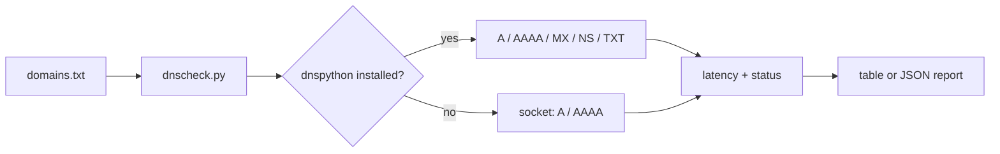

# DNS Health Checker

DNS failures and slow lookups cause hard-to-diagnose outages. This tool resolves a list of domains, records what came back and how long it took, and flags failures and slow responses.

> Portfolio project. Uses simulated/sample data only.

## Architecture



## Setup

```bash
git clone https://github.com/AJJudkins/dns-health-checker.git
cd dns-health-checker
# Python 3.9+. Optional for MX/NS/TXT records:
pip install dnspython
```

## Usage

```bash
python dnscheck.py sample_data/domains.txt          # real lookups
python dnscheck.py sample_data/domains.txt --demo   # canned offline resolver
python dnscheck.py sample_data/domains.txt --json
```

## Sample output

```text
resolver: socket (A/AAAA only)
example.com                  ok        0.0 ms  192.0.2.10
example.org                  slow    250.1 ms  192.0.2.10
example.net                  ok        0.0 ms  192.0.2.10
this-domain-should-not-exist.invalid fail      0.0 ms  NXDOMAIN

3/4 resolved, avg latency 83.4 ms

(Output of `--demo`: canned data using documentation address 192.0.2.10, with one simulated slow lookup and one simulated NXDOMAIN. Real runs depend on your resolver and network.)
```

## Tests

```bash
pip install -r requirements-dev.txt
pytest
```

## What this demonstrates

- Graceful optional dependency handling (dnspython with a standard-library fallback)
- Injectable resolver and clock, so tests run offline with mocks and no real DNS
- Latency measurement and simple status classification (ok / slow / fail)
- JSON output suitable for further tooling

## Limitations

- Real mode makes DNS queries from your machine; results depend on your local resolver.
- Some networks or sandboxes answer every name with a wildcard address, which makes failures impossible to detect.
- Single query per domain: no retries, no percentile statistics, no DNSSEC checks, no choice of nameserver.
- The 200 ms slow threshold is arbitrary.
- The socket fallback only reports A/AAAA records.

## License

MIT
